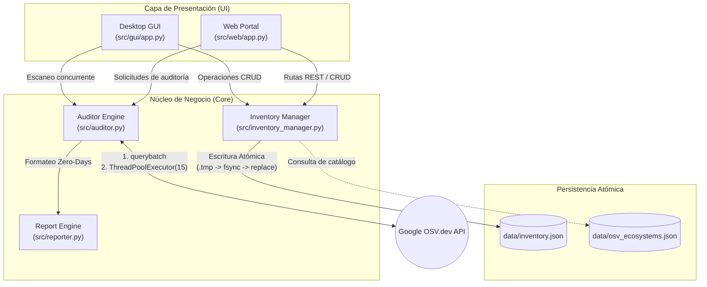

# Arquitectura del Sistema // OSV Threat Auditor

Este documento detalla la estructura interna, las decisiones de diseño y las garantías de determinismo del sistema.

## 1. Diagrama de Componentes

El sistema opera bajo un desacoplamiento estricto de capas: la capa de presentación no contiene lógica de negocio ni persistencia directa; consume funciones puras provistas por el Core. El siguiente diagrama está generado nativamente en Markdown.



---

## 2. Decisiones Técnicas Críticas

### A. Persistencia Atómica en Disco
Para evitar corrupción de datos durante cortes de suministro eléctrico o terminaciones abruptas del proceso (`SIGKILL`), la función `save_inventory_atomic` en `src/inventory_manager.py`:
1. Serializa el estado completo en un archivo temporal con extensión `.tmp`.
2. Invoca explícitamente `os.fsync(f.fileno())` para forzar al controlador del sistema de archivos a vaciar los búferes de memoria directamente al disco físico.
3. Aplica `os.replace()`, una llamada al sistema atómica en estándares POSIX y Windows que sustituye `inventory.json` sin dejar ventanas de tiempo con archivos a medio escribir.

### B. Rendimiento de Red e Hidratación Concurrente
El análisis contra la API de OSV.dev no realiza consultas lineales:
1. **Lote Inicial (`querybatch`):** Envía la totalidad de dependencias en un único payload JSON hacia `https://api.osv.dev/v1/querybatch`, reduciendo el costo de negociación TLS/TCP a una sola petición.
2. **Hidratación Asíncrona:** Extrae todos los identificadores únicos de vulnerabilidad detectados y despliega un grupo de hilos con `ThreadPoolExecutor(max_workers=15)` en `src/auditor.py` para consultar los detalles en paralelo.

### C. Saneamiento Determinista de Parches
Muchos registros de OSV reportan mitigaciones con identificadores de commit de Git en lugar de números de versión de paquetes de software. La función `extract_best_patch` utiliza la expresión regular:
```python
SHA1_REGEX = re.compile(r"^[0-9a-f]{40}$")
```
Se inspeccionan recursivamente todas las ramas del árbol JSON de la vulnerabilidad descartando cadenas que coincidan con 40 caracteres hexadecimales, conservando únicamente versiones semánticas válidas para calcular el parche óptimo con `packaging.version`.

### D. Concurrencia en la Interfaz Gráfica (Desktop)
Para asegurar que la interfaz de usuario en Tkinter no se bloquee ni entre en estado "No responde" durante escaneos masivos, `src/gui/app.py` desacopla el hilo principal del hilo de trabajo mediante un `queue.Queue` de paso de mensajes y temporizadores no bloqueantes `root.after()`.