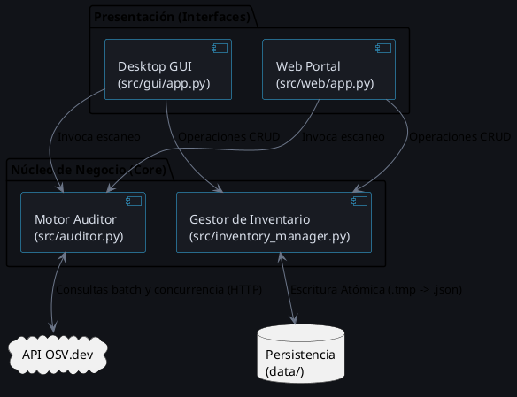

# Arquitectura del Sistema

El sistema utiliza una arquitectura de **capas puras**, separando completamente el motor lógico (Core) y la manipulación de datos de las interfaces de usuario (Desktop y Web).

## Diagrama de Componentes (PlantUML)

*(Nota: Este diagrama puede renderizarse con cualquier extensión de PlantUML de tu IDE o visores web).*

## Decisiones Críticas de Diseño

1. **Concurrencia de Red:** En lugar de escanear linealmente paquete por paquete, `auditor.py` realiza primero una consulta masiva (`querybatch`) a OSV.dev y luego hidrata los detalles complejos de las vulnerabilidades usando un `ThreadPoolExecutor` con 15 hilos en paralelo.
2. **Escritura Atómica de Archivos:** Para evitar corrupción del inventario base (`inventory.json`) durante apagones o fallas del servidor, la función `save_inventory_atomic` escribe la data nueva en un archivo temporal `.tmp`, fuerza la sincronización física del disco con `os.fsync()`, y finalmente realiza un reemplazo a nivel del sistema operativo.
3. **Determinismo e Inmutabilidad:** El estado de las dependencias se transfiere sistemáticamente mediante tuplas en lugar de listas para evitar efectos secundarios. Adicionalmente, las versiones con comodines o condiciones (`^`, `~`, `>`, `latest`) son estrictamente rechazadas mediante expresiones regulares para garantizar una validación exacta.